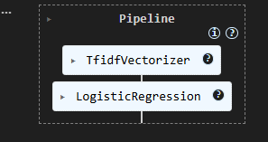
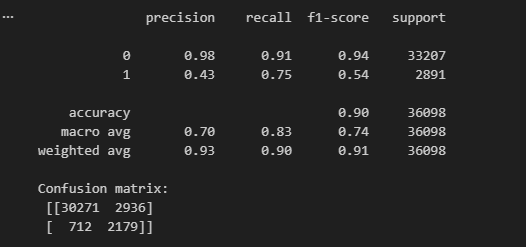

# Toxic Comments Classification with TF-IDF

Projet de classification binaire de commentaires toxiques. Le texte est
nettoyé puis transformé en vecteurs TF-IDF avant l'entraînement d'une régression
logistique pondérée pour tenir compte du déséquilibre des classes.



## Pipeline

1. Nettoyage du texte : minuscules, suppression des URL et normalisation des espaces.
2. Création d'une cible binaire : `toxicity >= 0.5`.
3. Séparation entraînement/test avec stratification.
4. Vectorisation TF-IDF sur les unigrammes et bigrammes, limitée à 20 000 variables.
5. Régression logistique avec pondération automatique des classes.
6. Évaluation avec précision, rappel, F1-score et matrice de confusion.

## Résultats du notebook

Le modèle a été évalué sur 36 098 commentaires :

- accuracy : **0,90** ;
- F1-score macro : **0,74** ;
- rappel de la classe toxique : **0,75** ;
- F1-score de la classe toxique : **0,54**.



Le rappel élevé de la classe toxique réduit les commentaires toxiques manqués,
mais la précision de cette classe reste limitée à 0,43. Le seuil de décision et
le compromis entre faux positifs et faux négatifs pourraient donc être optimisés.

## Contenu du dépôt

- [`toxic-comments-tfidf.ipynb`](toxic-comments-tfidf.ipynb) : pipeline et évaluation.
- [`docs/tfidf-presentation.pptx`](docs/tfidf-presentation.pptx) : présentation du projet.
- [`data/README.md`](data/README.md) : format attendu du dataset.

## Données et exécution

Le fichier de données original n'est pas inclus dans ce dépôt. Placez un fichier
`offensive_comments.csv` dans `data/`, avec au minimum les colonnes `text` et
`toxicity`, puis exécutez :

```bash
python -m venv .venv
.venv\Scripts\activate
pip install -r requirements.txt
jupyter notebook toxic-comments-tfidf.ipynb
```

## Périmètre exact

Le notebook réalise une **classification binaire** de la toxicité. Certaines
colonnes du dataset décrivent d'autres catégories, mais elles ne sont pas
modélisées dans cette version. TF-IDF tient compte de la fréquence des termes,
pas du contexte complet ni du sarcasme.

